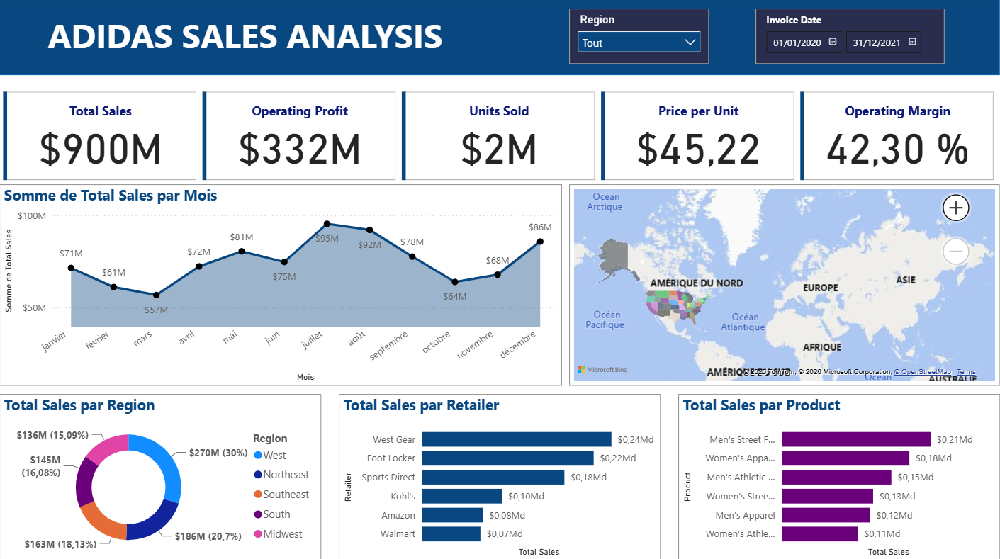

# Adidas Sales Analysis – Power BI Dashboard

Interactive Power BI dashboard analysing Adidas sales performance (2020–2021), built as a practice exercise.

## Objective

Turn raw sales data into clear, actionable insights for managers: understand sales dynamics, identify high-potential regions, products and retailers, and support pricing, stock and marketing decisions.

## Dashboard content

The dashboard is laid out in four rows, matching the screenshot above.

### 1. Header and filters
- **Region** slicer (dropdown, default "Tout" = all regions)
- **Invoice Date** range slicer (01/01/2020 – 31/12/2021)

### 2. Key Performance Indicators
| KPI | Value |
|---|---|
| Total Sales | $900M |
| Operating Profit | $332M |
| Units Sold | 2M |
| Price per Unit | $45.22 |
| Operating Margin | 42.30 % |

### 3. Trend and map
- **Total Sales by Month** – area chart with data labels. Sales peak in July ($95M) and August ($92M); the lowest month is March ($57M), with another dip in October ($64M). December closes strong at $86M.
- **Sales map** – Bing map showing sales by US state.

### 4. Breakdowns
| Visual | Type | Highlights |
|---|---|---|
| Total Sales by Region | Donut | West $270M (30 %), Northeast $186M (20.7 %), Southeast $163M (18.13 %), South $145M (16.08 %), Midwest $136M (15.09 %) |
| Total Sales by Retailer | Bar | West Gear ($0.24B), Foot Locker ($0.22B), Sports Direct ($0.18B), Kohl's ($0.10B), Amazon ($0.08B), Walmart ($0.07B) |
| Total Sales by Product | Bar | Men's Street Footwear ($0.21B), Women's Apparel ($0.18B), Men's Athletic Footwear ($0.15B), Women's Street Footwear ($0.13B), Men's Apparel ($0.12B), Women's Athletic Footwear ($0.11B) |

> Note: some labels in the report (month names, "Somme de", "Tout", "Md" for billions) appear in French because of the Power BI language settings.

## Key takeaways

1. The **West** region generates the most revenue (30 % of total sales), followed by the Northeast (20.7 %).
2. Sales peak in **summer (July–August)** and dip in March and October.
3. **West Gear** and **Foot Locker** are the top retailers; **footwear and apparel** lines dominate product sales, led by Men's Street Footwear.
4. A 42.30 % operating margin on $900M of sales shows strong profitability.

## Data

Adidas Sales Dataset (publicly available on Kaggle) with columns such as Retailer, Region, State, City, Product, Price per Unit, Units Sold, Total Sales, Operating Profit, Operating Margin and Invoice Date. Data was imported and cleaned with Power Query.

## How to open

1. Install [Power BI Desktop](https://powerbi.microsoft.com/desktop/) (Windows).
2. Download `Adidas-Sales-Analysis.pbix`.
3. Open it in Power BI Desktop.

## Tools

Power BI Desktop · Power Query · DAX
